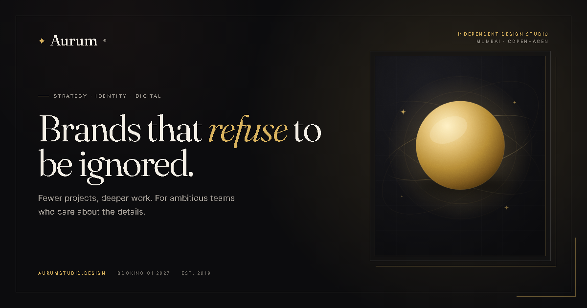

# Aurum Studio

<p>
  
  
  
  
  
  
</p>

**A fictional design-studio landing page built with vanilla HTML, CSS and JavaScript.**

Aurum Studio is a single-page concept site for an independent design studio. It is a front-end craft study focused on editorial typography, restrained motion, custom SVG artwork and accessible interactions. The content is intentionally fictional, and the enquiry form is a browser-only demo.



## Overview

The site presents a complete studio narrative in one scroll: hero, selected work, studio story, services, process, testimonials, pricing, FAQ and contact. It is fully responsive, has no framework or build step, and can be opened directly in a browser or served as a static site.

The visual direction is a "midnight premium" palette: near-black ink, warm paper text, muted gold accents and a serif display face paired with a clean sans-serif for UI copy.

## Features

- **Responsive single-page layout** that works from small phones to wide desktops.
- **Custom design system** using CSS custom properties, Grid, Flexbox, `clamp()` and fluid type.
- **Editorial hero** with custom SVG artwork, a pointer-follow spotlight, animated statistics and a client marquee.
- **Selected work grid** with four project cards and an accessible case-study dialog.
- **Studio, services, process, testimonials, pricing, FAQ and contact sections.**
- **Manual testimonial carousel** with generated dots, previous/next controls and keyboard support.
- **Pricing-to-contact flow** that prefills the enquiry form's budget and moves focus to the form.
- **Client-side form validation** with inline errors and a simulated success state.
- **Sticky header behaviour**, active navigation highlighting, reveal-on-scroll animation and a back-to-top control.
- **Accessibility-minded interactions**: skip link, semantic landmarks, ARIA states, focus management, Escape-to-close and `prefers-reduced-motion` support.
- **SEO and social metadata**, including a generated 1200 x 630 Open Graph image.
- **Zero runtime dependencies** and no package manager required.

## Tech stack

| Layer | What is used |
| --- | --- |
| Markup | Semantic HTML5 |
| Styling | Modern CSS: custom properties, Grid, Flexbox, `clamp()`, transitions |
| Behaviour | Vanilla JavaScript (ES6+), no framework |
| Artwork | Custom SVG assets and inline SVG |
| Type | Fraunces and Inter, loaded from Google Fonts |
| Tooling | None required; no build step, bundler or package manager |

## Project structure

```text
aurum-studio/
├── index.html
├── css/
│   └── styles.css
├── js/
│   └── main.js
├── assets/
│   └── images/
│       ├── hero-art.svg
│       ├── studio-art.svg
│       ├── work-solace.svg
│       ├── work-orbit.svg
│       ├── work-nocturne.svg
│       ├── work-atlas.svg
│       ├── grain.svg
│       └── og-image.png
├── favicon.svg
├── README.md
└── LICENSE
```

## Run locally

No installation or build step is required.

### Option 1: Open the file

Open `index.html` in a modern browser.

### Option 2: Use a local server (recommended)

From the project root, run one of the following:

```bash
# Python 3
python -m http.server 8080
```

```bash
# Node.js (uses npx only to launch a static server)
npx serve .
```

Then open <http://localhost:8080>.

A local server is recommended so relative asset paths and browser security behave like a normal deployment. The Google Fonts request needs an internet connection; see the customization notes below if you want to self-host the fonts.

## Customize it

- **Copy and sections:** edit `index.html`.
- **Colours, spacing, type and motion:** edit the design tokens at the top of `css/styles.css` inside `:root`.
- **Project and case-study data:** edit the `projects` object in `js/main.js`.
- **Artwork:** replace the SVGs in `assets/images/`. Keep the same aspect ratios or update the `width` and `height` attributes in `index.html`.
- **Social preview:** replace `assets/images/og-image.png` with your own 1200 x 630 image and update the metadata in `index.html`.
- **Fonts:** the site loads Fraunces and Inter from Google Fonts. For offline or privacy-focused deployments, self-host the font files and update the font loading in `index.html`.

## Demo content notice

Aurum Studio is a fictional brand created for this project. The projects, clients, testimonials, prices, email addresses and availability shown in the demo are placeholders, not real commercial claims. The contact form validates and simulates a successful submission entirely in the browser; it does not send data anywhere.

## Browser support

Built for current versions of Chrome, Edge, Firefox and Safari. The site uses modern platform features such as `<dialog>`, `inert`, `IntersectionObserver` and CSS custom properties.

## Author and credits

Created and maintained by **[mukund-buddy](https://github.com/mukund-buddy)**.

- **Design, layout, HTML, CSS and JavaScript:** mukund-buddy.
- **Typefaces:** [Fraunces](https://fonts.google.com/specimen/Fraunces) and [Inter](https://fonts.google.com/specimen/Inter), served by Google Fonts and licensed under the SIL Open Font License 1.1.
- **SVG artwork and Open Graph image:** included with this project; see the disclaimer below.
- **Third-party JavaScript libraries or UI frameworks:** none bundled.

## Third-party assets and disclaimer

This project is shared purely for educational and inspirational purposes. While the overall design and structure were built by **mukund-buddy**, not every single asset, font, icon, library or inspiration belongs exclusively to the author. All third-party assets, libraries, typefaces, trademarks and inspiration belong to their respective owners.

The project is provided **"as is"**, without warranties of any kind, express or implied. You are responsible for checking the licences of any third-party assets before using them in a commercial project. The fictional names, brands and content are not connected to any real company.

## Usage and inspiration policy

You are free to copy, modify, take inspiration from, and build your own projects using this code **without needing prior approval**.

You can:

- fork the repository and experiment with it;
- reuse the layout, interactions and visual direction in your own work;
- use it as a starting point for a personal or commercial project;
- share your version with others.

If you redistribute the code, keep the MIT copyright and licence notice. A visible credit is appreciated, but not required. Please do not claim that a substantially unchanged copy of this project was created entirely by you.

## Friendly ping

If you decide to use this project or take inspiration from it, I would love to hear about it. A quick message is **not** required, but the creator genuinely loves knowing where the work is being used, and is happy to help if you have any doubts or questions.

**Email:** [jmukund9625@gmail.com](mailto:jmukund9625@gmail.com)  
**GitHub:** [@mukund-buddy](https://github.com/mukund-buddy)

## Contributing

Issues and pull requests are welcome. For larger changes, please open an issue first so the direction can be discussed before significant work is done.

## License

Released under the [MIT License](LICENSE).

Copyright (c) 2026 mukund-buddy.
